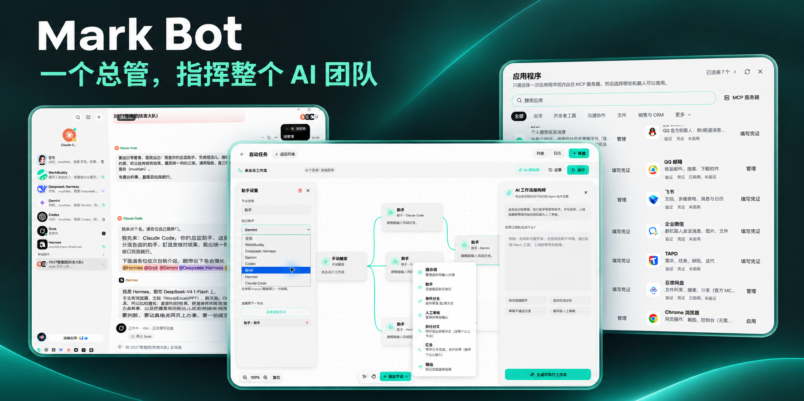
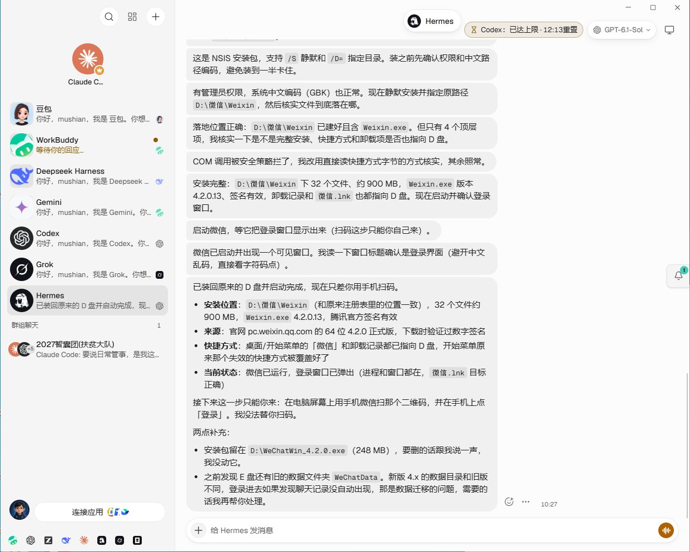
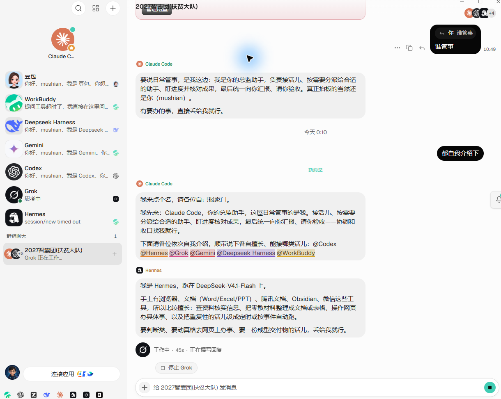
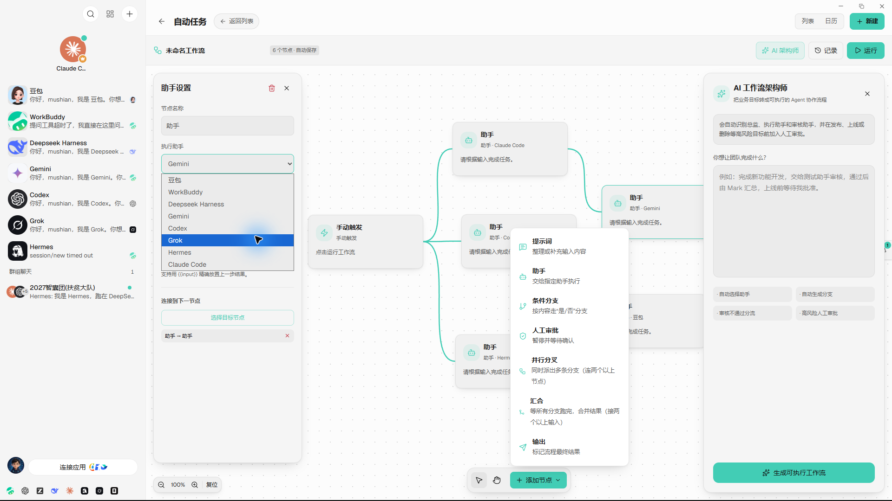
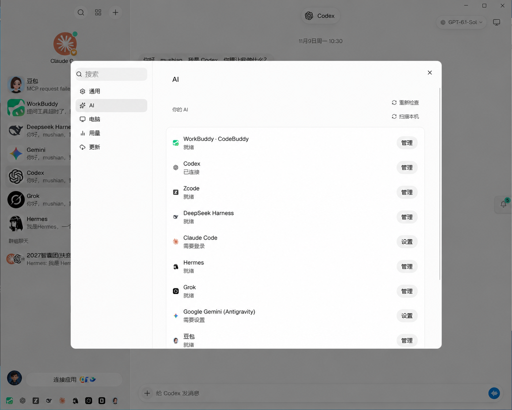
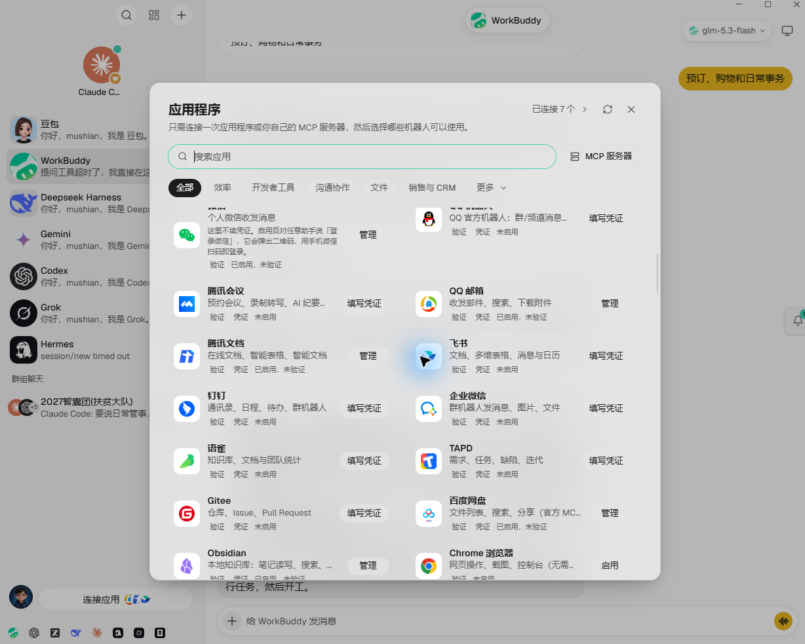

<div align="center">

# Mark Bot

### A local AI team led by one chief agent

You talk to one chief agent and review the result. The chief breaks work down,
delegates it to specialist agents, tracks progress, and returns one finished delivery.

[简体中文](README.zh-CN.md) · [Download](https://github.com/markmushian/markbot/releases/latest) · [Releases](https://github.com/markmushian/markbot/releases) · [Issues](https://github.com/markmushian/markbot/issues)


[](https://github.com/markmushian/markbot/releases/latest)

<br>



</div>

## What Mark Bot is

Mark Bot is a desktop workspace for running several AI agents as one team:

- **Chief-agent orchestration** — one lead agent plans, delegates, follows up, combines results, and reports back to you.
- **Specialist agents** — create separate agents for research, coding, data, operations, writing, design, or any role you need.
- **Team rooms** — put agents in one group chat, mention them by name, and let the chief coordinate the discussion.
- **Workflow canvas** — connect triggers, agent nodes, conditions, approvals, and delivery steps into repeatable automations.
- **Independent workspaces** — each agent can have its own model, instructions, memory, tools, connected apps, and computer permissions.
- **Local-first desktop app** — conversations, configuration, and local credentials stay on your computer.
- **Chinese-first experience** — Simplified Chinese is a primary maintained interface language, with Traditional Chinese and other locales included.

## How the team works

```text
You
 └─ Chief agent
     ├─ Research agent   → sources and analysis
     ├─ Coding agent     → implementation and tests
     ├─ Data agent       → spreadsheets and reports
     └─ Operations agent → content and execution
              ↓
       Chief agent reviews, combines, and delivers
```

Agents may work in their own conversations while the chief coordinates them from a
team room. You remain the final reviewer instead of manually relaying every message.

## Models and providers

Mark Bot can reuse model tools already installed and signed in on your computer.
The current desktop experience focuses on:

| Provider | Connection | Notes |
|---|---|---|
| OpenAI Codex | Local CLI | Reuses the local Codex login |
| Claude Code | Local CLI | Reuses the local Claude Code login |
| WorkBuddy / CodeBuddy | Local CLI | Detects supported desktop installations and offers one-click setup |
| Grok, Kimi, Qwen, Hermes and others | CLI or compatible endpoint | Configure and test under **Settings → AI** |

Each agent can use a different provider and model. Availability depends on the tools,
accounts, and endpoints configured on the user's machine.

## Quick start

1. Download the latest desktop build from [Releases](https://github.com/markmushian/markbot/releases/latest).
2. On first launch, choose your display name, chief-agent name, provider, and model.
3. Open **Settings → AI** and scan for locally installed model tools.
4. Create specialist agents or start from a team template.
5. Create a team room, choose the chief, and let it delegate and collect the work.

The packaged desktop app starts its local bot service automatically. `pnpm dev:server`
is only needed when developing from source.

## Core areas

### Multi-agent conversations

Chat with an individual specialist or bring several agents into one room. Mentions,
lead-agent rules, independent threads, and resumable tasks keep responsibilities clear.

### Workflow canvas

Build automations visually with triggers, agent steps, branching conditions, approvals,
and delivery nodes. Workflows are designed to dispatch real tasks to the selected agents,
not just draw a static diagram.

### Tools, apps, and computers

Grant each agent only the capabilities it needs: MCP servers, connected applications,
the built-in browser, local computer access, or a remote workspace. Permission prompts
keep sensitive actions visible to the user.

### Profiles and model identity

Give every agent a recognizable name, role, avatar, instructions, voice, memory, provider,
and default model. Bundled provider and app icons work offline, including on networks where
remote favicon services are unavailable.

## Build from source

```bash
git clone https://github.com/markmushian/markbot.git
cd markbot
pnpm install
pnpm dev:server
pnpm dev
```

Run the same basic quality gates used before pushing:

```bash
pnpm i18n:check
pnpm lint
pnpm typecheck
pnpm exec vite build
```

## Product screenshots

### Individual agents and conversations



### Chief-led team room



### Executable workflow canvas



### Local AI providers



### Connected applications and MCP



## Project identity and attribution

Mark Bot is an independent project built from Apache-2.0-licensed OpenMausBot source and
substantially modified in branding, Chinese UX, desktop startup, model integration,
multi-agent coordination, and workflow functionality. OpenMausBot remains the upstream
project name and is not the Mark Bot product name or mascot.

See [MARKBOT-NOTICE.md](MARKBOT-NOTICE.md) for provenance and modification details.

License: [Apache License 2.0](LICENSE)
