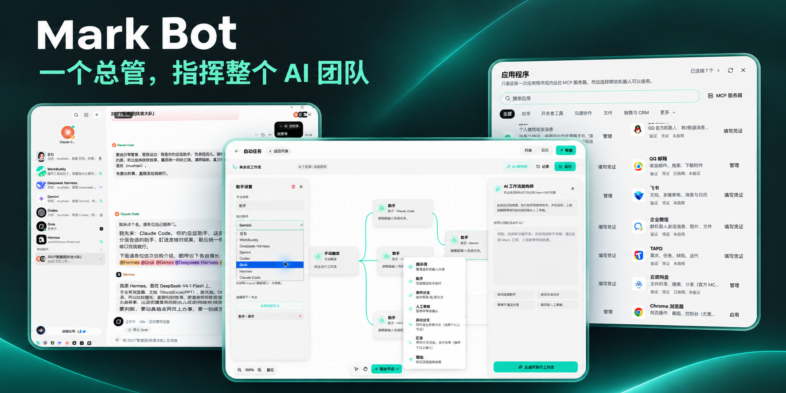
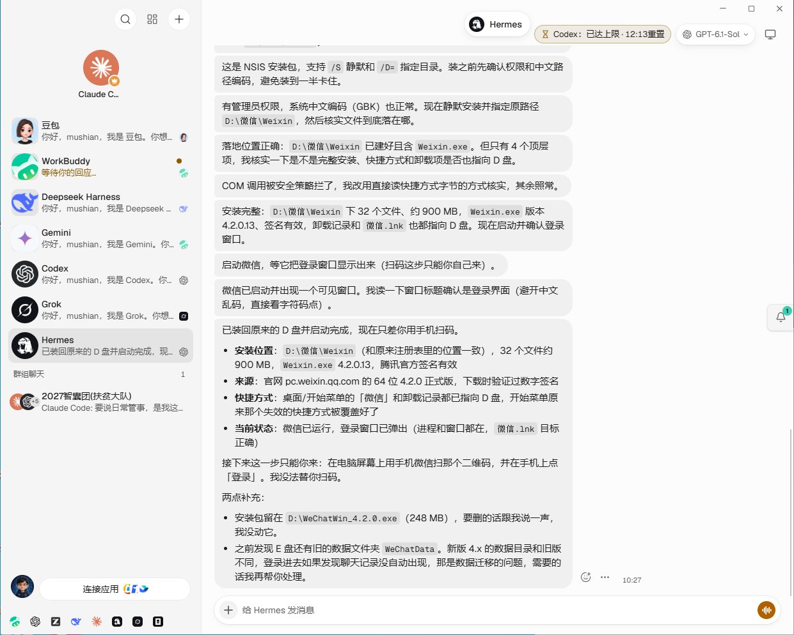
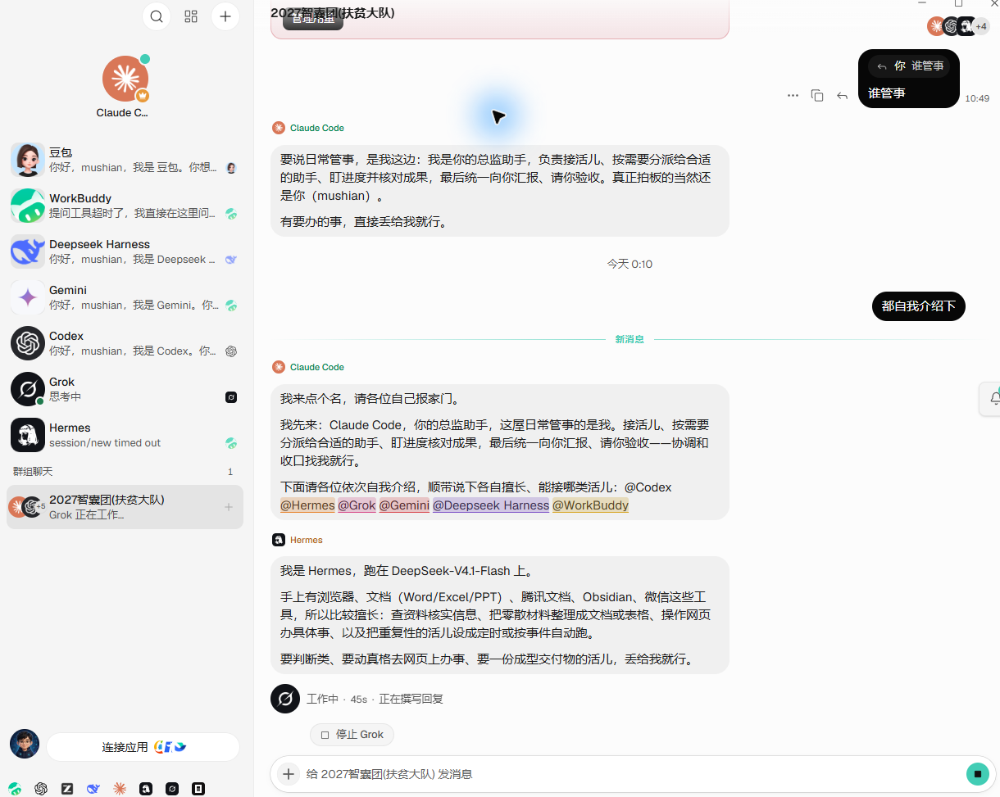
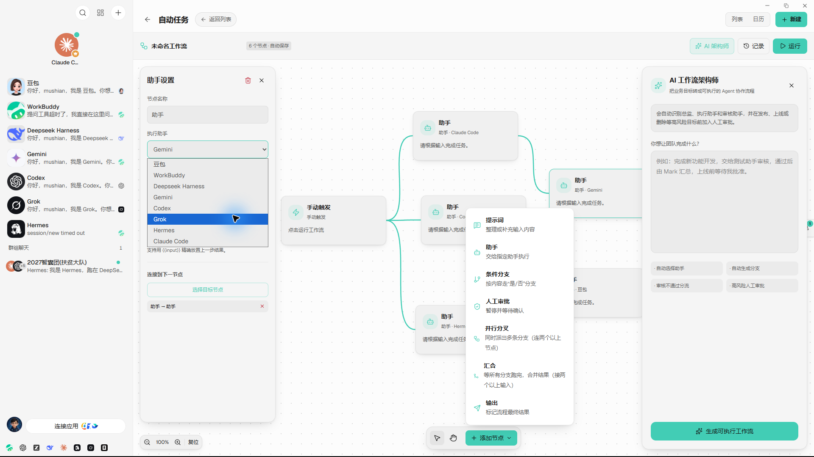
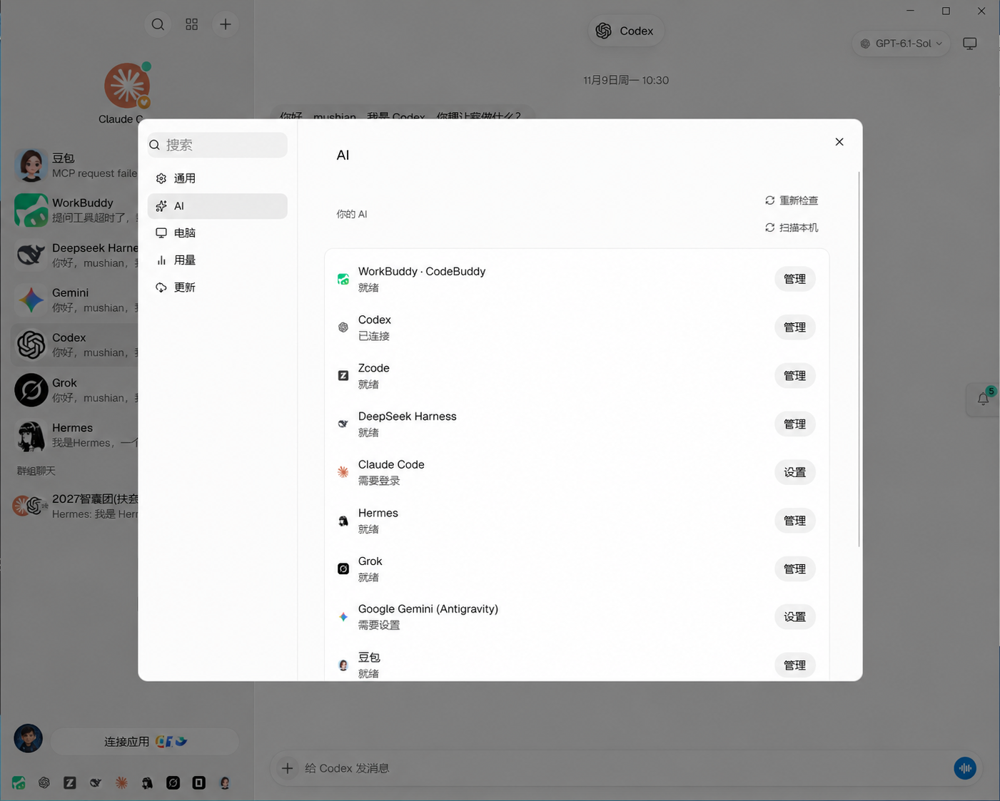
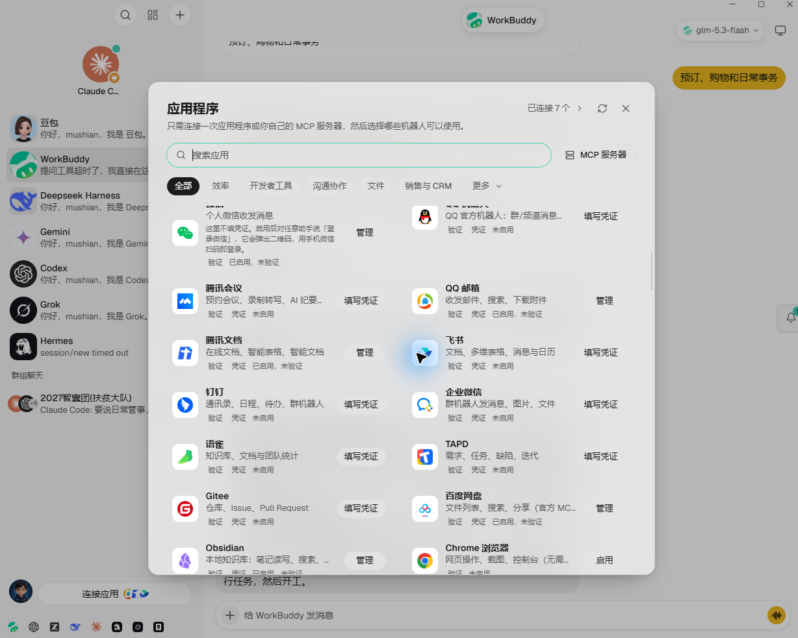

<div align="center">

[English](README.md) · **简体中文**

# Mark Bot

### 一个总管指挥多个专业 AI 助手的本地工作台

你只需要和总管沟通、验收结果。总管可以拆解任务、组织群聊、把工作派给不同助手；每个助手在自己的会话中使用独立模型、记忆、工具和电脑完成任务。

[下载 Windows 版](https://github.com/markmushian/markbot/releases/latest) · [查看版本](https://github.com/markmushian/markbot/releases) · [问题反馈](https://github.com/markmushian/markbot/issues)

<br>



</div>

## 核心能力

- **多助手协作**：为研究、编程、运营、数据、设计等工作建立不同助手。
- **总管调度**：由一个总管负责拆解、派发、追踪、汇总和验收。
- **群聊协同**：把多个助手加入同一群聊，用 `@助手名` 指派工作。
- **工作流画布**：用触发器、助手节点、条件和交付节点编排自动任务。
- **本地优先**：聊天、配置和密钥保存在本机；桌面版自动启动本地机器人服务。
- **多模型接入**：支持本机已登录的 Codex、Claude Code、WorkBuddy / CodeBuddy，以及其他兼容 CLI 或 API 的服务商。
- **电脑与工具**：助手可按权限使用浏览器、本地电脑、MCP 工具和已连接应用。
- **中文界面**：简体中文为重点维护语言，同时保留其他语言包。

## 工作方式

```text
你 → 总管助手 → 拆解任务
             ├─ 研究助手：检索与分析
             ├─ 编程助手：开发与测试
             ├─ 数据助手：表格与报告
             └─ 运营助手：内容与发布
                  ↓
             总管汇总并交付给你验收
```

## 快速开始

1. 从 [Releases](https://github.com/markmushian/markbot/releases/latest) 下载 Windows 安装包。
2. 首次启动时设置你的称呼、总管名称、服务商和模型。
3. 在“设置 → AI”使用扫描功能接入本机已安装的模型工具。
4. 新建不同职责的助手，或从模板创建团队。
5. 建立群聊并指定总管，让总管负责分工和汇总。

桌面正式版会自动启动本地机器人服务，不需要用户手动执行 `pnpm dev:server`。该命令只用于源码开发。

## 模型与通道

Mark Bot 优先复用你电脑上已经登录的 CLI，不要求把订阅账号交给中间服务器。当前重点支持：

| 通道 | 接入方式 | 说明 |
|---|---|---|
| OpenAI Codex | 本地 CLI | 复用桌面/CLI 登录状态 |
| Claude Code | 本地 CLI | 复用 Claude Code 登录状态 |
| WorkBuddy / CodeBuddy | 本地 CLI | 自动扫描桌面版内置 CLI，可一键接入 |
| Grok、Kimi、Qwen、Hermes 等 | CLI 或兼容接口 | 在“设置 → AI”中检测和配置 |

## 开发与验证

```bash
pnpm install
pnpm dev:server
pnpm dev
```

提交前运行与 GitHub CI 相同的基础门禁：

```bash
pnpm i18n:check
pnpm lint
pnpm typecheck
pnpm exec vite build
```

## 产品界面

### 多个独立助手与会话



### 总管带领的团队群聊



### 可执行的工作流画布



### 本机 AI 服务商与模型



### 应用连接与 MCP 工具



## 开源说明

Mark Bot 基于 OpenMausBot 的 Apache-2.0 源码开发，并进行了品牌、中文体验、桌面启动、多助手调度、模型接入和工作流等方向的改造。归属与改动说明见 [MARKBOT-NOTICE.md](MARKBOT-NOTICE.md)。

许可证：[Apache-2.0](LICENSE)
